# Agent Career Workflow

**Build a private career evidence base. Explore suitable work. Search regularly. Prepare truthful applications.**

This repository gives people and their AI agents a practical job-search and career-development workflow.
It combines guided conversations, ordinary Markdown records and a small Python toolkit.
It does not apply for jobs, impersonate candidates or promise employment outcomes.

> **Synthetic examples only.** The demonstration profile, employers, roles and application history are invented.
> They are not an anonymised copy of a real person's records. Example vacancies are not real opportunities.

## Point your agent here

Give your agent this request:

> Read this repository's README and `prompts/onboarding.md`. Help me adapt the workflow to my career goals.
> Start by asking about my context and privacy boundaries. Do not assume my profession, location or constraints.
> Keep my private records outside the public repository. Ask before enabling integrations, scheduling or sending anything.

The agent should guide the conversation. You should not need to fill every template before receiving useful help.
Start with a modest profile, one role lane and a manual search pilot. Expand when there is a clear benefit.

## The approach

```mermaid
flowchart LR
  A[Personal context and consent] --> B[Professional portfolio and evidence]
  B --> C[Role lanes and search agreement]
  C --> D[Bounded discovery and official checks]
  D --> E[Private dashboard and digest]
  E --> F[Choose a role]
  F --> G[Evidence matrix and tailored drafts]
  G --> H[Review and human release]
  H --> I[Human-reported submission and outcomes]
  I --> J[Feedback and career development]
  J --> C
```



### 1. Gather context, not just a CV

Personal context covers practical constraints, values, working preferences and what the person does not want to disclose.
Professional context covers work history, qualifications, projects, capabilities, interests and future directions.
Keep verified facts separate from aspirations, transferable evidence and unanswered questions.

### 2. Build a living evidence portfolio

Maintain a factual Master CV and small evidence records with sources and claim boundaries.
Chat updates should correct the authoritative records, not produce another disconnected CV version.
Past applications help locate evidence. They are not independent proof that a claim is true.

### 3. Agree a search strategy

Choose a small set of role lanes, exclusions, employers, locations and source families.
Use search engines and job platforms to locate leads. Check employer-controlled listings before recommending roles.
Record source coverage and access failures. A quiet digest is not evidence that the whole market is empty.

### 4. Turn discovery into decisions

Keep a full private role ledger, but show a small dashboard of current candidates and reported applications.
A digest highlights decisions, deadlines, changes and uncertainty. Explicit feedback improves the next search.
Preparation, submission, employer receipt and outcomes are separate events.

### 5. Prepare applications from evidence

Capture the official advert, position description, application requirements and any employer AI-use rules.
Map requirements to direct and transferable evidence before drafting. Keep material gaps in a private review matrix.
Review content, voice, export quality and layout. A human approves release and decides whether to submit.

## What works in this version

| Included and runnable | Requires the user's setup or another tool |
|---|---|
| Private Markdown vault initialisation | Conversational agent and model access |
| Offline synthetic demonstration | Web search beyond the included public ATS connectors |
| Greenhouse and Lever public-board lead collection | Approved employer-to-board mapping and source selection |
| Record validation and conservative lifecycle gates | Judgement about evidence, official ownership and suitability |
| Static local dashboard and Markdown/HTML digest | A scheduler and an approved email/chat delivery route |
| Durable CLI feedback, preparation scaffolds and submission recording | Candidate-authored content, independent review and final approval |
| Rebuildable local SQLite search index | Optional external knowledge graph, embeddings or cloud sync |
| Unsent email-draft and safe toolkit-export helpers | DOCX/PDF generation, visual review and any document uploads |

**Nothing is scheduled, sent or published when you install or run the demo.**
The `scan` command collects leads. It does not turn API results into verified recommendations.
The dashboard's feedback controls copy a prompt; they do not silently save data through a web server.

## Quick start: see the synthetic workflow

Requirements: Python 3.11 or newer, Linux or macOS. On Windows, use WSL.
No runtime dependencies, account credentials or network access are needed for this demo.
Run these commands from the repository root:

```sh
python3 -m careerflow init "$HOME/career-demo" --demo
python3 -m careerflow validate "$HOME/career-demo"
python3 -m careerflow dashboard "$HOME/career-demo"
python3 -m careerflow digest "$HOME/career-demo"
python3 -m careerflow index "$HOME/career-demo"
python3 -m careerflow search "$HOME/career-demo" operations
```

Open `$HOME/career-demo/output/dashboard.html` in a browser.
Read `$HOME/career-demo/output/digest.md` or `digest.html`.
The example remains visibly synthetic, including any simulated application history.

For a preview without running Python, open [the bundled dashboard](examples/Dashboard.html)
locally or read [the synthetic digest](examples/Digest.md). These are fixed teaching snapshots.
The [worked application](examples/Worked%20application.md) shows evidence selection and claim boundaries.

For a real private workspace, choose a **different** directory:

```sh
python3 -m careerflow init "$HOME/my-career-vault"
```

Choose unused directories. Vault paths must not contain `..` or symlink components.
Do not rename the demo as your factual portfolio. Start empty and add your own reviewed evidence.
Open the private vault folder in Obsidian if you like. Obsidian is optional.
Use any text editor otherwise. Do not enable public sharing for the vault.

Optional installation in a virtual environment provides the `careerflow` command:

```sh
python3 -m venv .venv
. .venv/bin/activate
python -m pip install .
careerflow --help
```

Installation may fetch build tooling. Running directly with `python3 -m careerflow` avoids that requirement.

## Repository and private vault

```text
PUBLIC TOOLKIT                         PRIVATE VAULT (outside the clone)
README.md                              00-start-here.md
prompts/                               profile/
  onboarding.md                          Personal context.md
  daily-scan.md                          Professional context.md
  weekly-review.md                       Master CV.md
  prepare-application.md                 Role preferences.md
  update-profile.md                      Access decisions.md
  independent-review.md                evidence/       # sourced claims
docs/                                  roles/          # one Markdown role record
careerflow/                             employers/      # no-vacancy watchlist
scripts/                                applications/   # drafts, evidence and review
tests/                                  feedback/       # explicit preference events
examples/                               scans/          # coverage and failures
.github/workflows/check.yml              decisions/      # human approvals and corrections
                                        config.json     # non-secret source choices
                                        output/         # disposable private projections
```

Markdown records are authoritative. Configuration is JSON for portability.
SQLite is a search projection; deleting it does not delete career evidence.
The toolkit backup and the private-vault backup must remain separate.

## Using real sources

First agree the source roster and employer-to-board mapping with your agent.
Add approved board slugs to the **private vault's** `config.json`:

```json
{
  "schema_version": 1,
  "mode": "private",
  "timezone": "UTC",
  "max_verification_age_days": 7,
  "sources": [
    {"adapter": "greenhouse", "board": "approved-board-slug", "organisation": "Approved employer"}
  ]
}
```

The board above is an example placeholder, not a working employer endpoint.
Then run `python3 -m careerflow scan "$HOME/my-career-vault"`.
The agent must inspect each retained official listing and document its verification before promotion.
Public APIs do not cover the whole market. Use the daily-scan prompt for the broader search and verification workflow.

## Chat maintenance and applications

Examples of requests to your agent:

- “Add this project to my professional portfolio. Ask me about missing outcomes before making claims.”
- “I am interested in this role because of the work, not the seniority. Record that distinction.”
- “Correct this employment date everywhere it is authoritative. Show me the proposed changes first.”
- “Compare these roles against my constraints and evidence. Separate direct fit from a plausible stretch.”
- “Prepare a requirement-to-evidence matrix before writing the application.”
- “I submitted this application today. Record my report without inventing an employer response.”
- “Remove this sensitive detail and tell me which backups or external indexes may still retain it.”

For executable commands and fields, use `python3 -m careerflow --help` and each subcommand's `--help`.
A command gate records an attestation; it cannot verify that an agent actually obtained human consent.

## Regular digests

Use `prompts/daily-scan.md` with your agent's scheduler after a successful manual pilot.
Agree cadence, timezone, source budget, recipient, permitted transport and failure behaviour first.
The toolkit renders digest files locally. It does not install a scheduler or send messages.

To prepare an **unsent** email for review:

```sh
python3 scripts/draft_email.py "$HOME/career-demo/output/digest.md" "$HOME/career-demo/output/digest.eml" \
  --sender sender@example.org --recipient reader@example.org --subject "Synthetic career digest"
```

Use your own approved addresses only in your private environment.
A prepared email is not a delivered email. Require a transport acknowledgement before reporting a send.
Do not replay a send when its outcome is unknown.

## Read more

- [Methodology](docs/Methodology.md)
- [Private vault and chat maintenance](docs/Private%20vault.md)
- [Search and discovery](docs/Search%20and%20discovery.md)
- [Application preparation](docs/Applications.md)
- [Integration and scheduling decisions](docs/Integrations.md)
- [Privacy and approvals](docs/Privacy%20and%20approvals.md)
- [Record format](docs/Record%20format.md)
- [Operating and delivery checks](docs/Operations%20and%20delivery.md)
- [Security boundary](SECURITY.md)
- [Contributing](CONTRIBUTING.md)

## Check and back up the toolkit

```sh
python3 -m unittest discover -s tests -v
python3 scripts/privacy_check.py .
python3 scripts/export_repo.py ../agent-career-workflow-release.zip
```

The release archive includes an exact file manifest and content hashes.
It excludes private vaults, Git history, environments and runtime data.
The privacy checker is a useful backstop, not a substitute for reading what you publish.
Review author metadata and Git history separately before public release.

Optional browser QA uses Playwright in a separate development environment:

```sh
python -m pip install playwright
python -m playwright install chromium
python scripts/browser_smoke.py
```

This checks real Chromium filtering, feedback preparation, console errors and desktop/mobile overflow.
Playwright is not required to use the toolkit. The check makes no application or email send.

## Status and limits

This is an early, inspectable implementation of a practitioner workflow, not a validated career intervention.
It does not predict hiring decisions or establish that generated documents will pass every ATS.
The demonstration proves local workflow behaviour, not live-source coverage, email delivery or job-search effectiveness.

MIT licence. No real candidate history, account configuration or private application materials are included.
